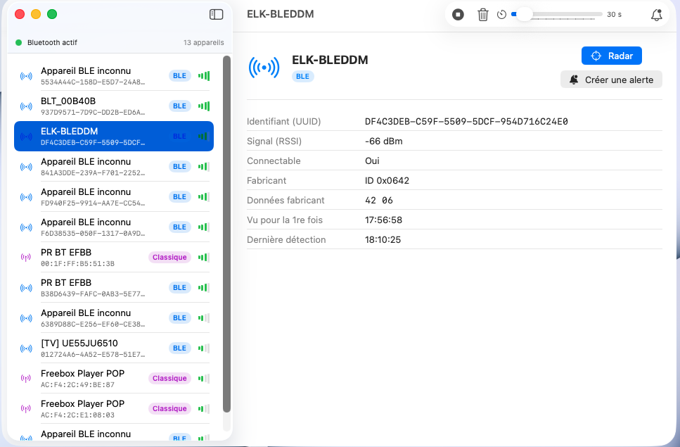
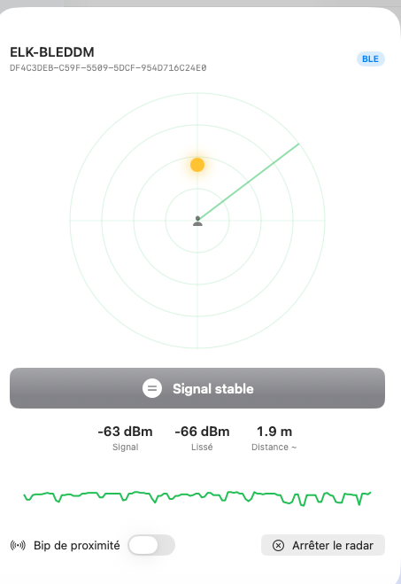
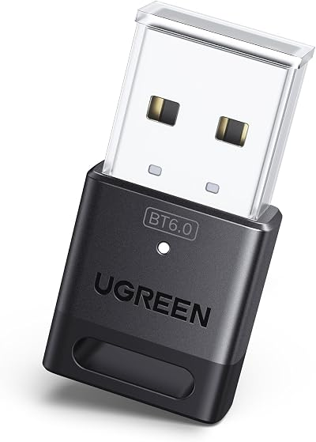
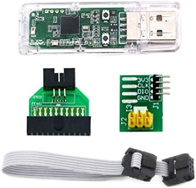
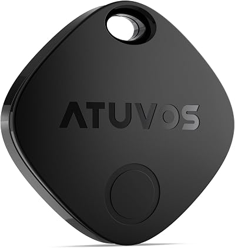

# Bluetooth Radar

<p align="center">🇺🇸 <b>English</b> · 🇫🇷 <a href="README.fr.md">Français</a></p>

A macOS app (SwiftUI) that detects Bluetooth devices **in range** (without connecting to them),
shows their details, fires a **visual + audible alert** when a watched address
shows up, and offers a **radar mode** to tell whether you're **getting closer** to a device.

<p align="center">
  
</p>

## Features
- **Hybrid scan**: BLE (CoreBluetooth) + classic Bluetooth (IOBluetooth).
- **Per-device details**: address, RSSI, manufacturer, services, device class, timestamp.
- **Alerts** by **MAC address**, **UUID** or **name fragment** — visual (red banner
  + Dock bounce) and audible. **Loaded and active at launch.**
- **Radar mode**: follows a device's signal, tells you *"getting closer / moving away"*,
  with a Geiger-style proximity beep (faster and faster as you get closer).
- **Scan cycle adjustable from 10 s to 5 min**.

<p align="center">
  
</p>

## Installation
1. Download **`BluetoothRadar-1.0.dmg`** from the
   [Releases](../../releases) page.
2. Open the DMG, drag **Bluetooth Radar** into **Applications**.
3. **Get past Gatekeeper** (the app is ad-hoc signed but not notarized by Apple, so macOS
   blocks it on first launch — that's expected). Two ways:
   - **System Settings**: double-click the app → click **OK** on the warning →
     **System Settings → Privacy & Security** → *Security* section → **"Open Anyway"**
     button → authenticate.
   - **Terminal** (once):
     ```bash
     xattr -dr com.apple.quarantine "/Applications/Bluetooth Radar.app"
     ```
   > On macOS Sequoia (15) and later, the old "right-click → Open" no longer works:
   > use one of the two methods above.
4. Accept the **Bluetooth** permission request (otherwise the scan stays empty).

The DMG is **universal** (Intel **and** Apple Silicon Macs).

## Important limitation — MAC addresses on macOS
- **Classic Bluetooth** → real **MAC address** (reliable for alerts).
- **BLE** → macOS does **not** expose the MAC, only a **UUID** specific to this Mac (not
  necessarily stable). To watch a BLE device, use its **name** or its **UUID**
  as the alert criterion. Radar mode works best with BLE (RSSI updated often);
  with classic Bluetooth, RSSI is often unavailable.

## Building from source
Requires the **Command Line Tools** (not the full Xcode).
```bash
./build.sh              # arm64 (Apple Silicon)
./build.sh --universal  # universal arm64 + x86_64
./make_dmg.sh           # produces build/BluetoothRadar-1.0.dmg
```

## Architecture
| File | Role |
|---|---|
| `BLEScanner.swift` | BLE scan (CoreBluetooth) — UUID, RSSI, services, manufacturer |
| `ClassicScanner.swift` | Classic scan (IOBluetooth) — real MAC address |
| `ScanCoordinator.swift` | Merges the scanners, scan cycle, alerts, radar mode |
| `AlertStore.swift` | Watched criteria, persistence, matching |
| `RadarView.swift` | Proximity radar screen |

## ☕ Buy me a coffee

This app is free and open source. If you find it useful, you can say thanks
by buying me a coffee — just scan this PayPal QR code. Thanks a lot! 🙏

<p align="center">
  
</p>

## License

[MIT](LICENSE) © 2026 koua29

---

## 🛒 Bluetooth gear

*Amazon affiliate links: if you buy through these links, the project earns a small commission at no extra cost to you.*

<table>
<tr>
<td align="center" width="33%">
  <a href="https://www.amazon.com/dp/B0DYV5MPLF?linkCode=ll2&amp;tag=koua29btradar-20&amp;ref_=as_li_ss_tl"></a><br>
  <b><a href="https://www.amazon.com/dp/B0DYV5MPLF?linkCode=ll2&amp;tag=koua29btradar-20&amp;ref_=as_li_ss_tl">UGREEN USB Bluetooth 6.0 adapter</a></b><br><sub>Adds fast Bluetooth scanning to any PC or Mac</sub>
</td>
<td align="center" width="33%">
  <a href="https://www.amazon.com/dp/B083SJF919?linkCode=ll2&amp;tag=koua29btradar-20&amp;ref_=as_li_ss_tl"></a><br>
  <b><a href="https://www.amazon.com/dp/B083SJF919?linkCode=ll2&amp;tag=koua29btradar-20&amp;ref_=as_li_ss_tl">Taidacent nRF52840 BLE dongle</a></b><br><sub>A real BLE sniffer for nRF Connect</sub>
</td>
<td align="center" width="33%">
  <a href="https://www.amazon.com/dp/B0C2ZL46QC?linkCode=ll2&amp;tag=koua29btradar-20&amp;ref_=as_li_ss_tl"></a><br>
  <b><a href="https://www.amazon.com/dp/B0C2ZL46QC?linkCode=ll2&amp;tag=koua29btradar-20&amp;ref_=as_li_ss_tl">ATUVOS item tracker (Find My)</a></b><br><sub>A cheap BLE tag to see what the radar catches</sub>
</td>
</tr>
</table>

<sub>As an Amazon Associate I earn from qualifying purchases.</sub>
